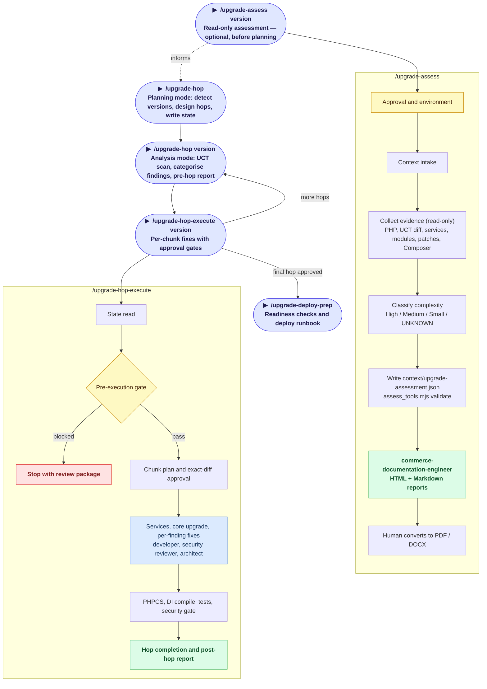

# Upgrade Workflow — Agent Orchestrator

The current CLI session acts as the `orchestrator` and runs each slash command directly;
no custom-agent selection is required. Specialist agents are dispatched per step.

## UCT prerequisite

`/upgrade-assess <version>` and `/upgrade-hop <version>` share a gate that verifies
registered Magento, Composer and reviewed standalone UCT executables. The no-version
roadmap is exempt. Manual setup is followed by live re-probing; installation alone is
not completed assessment evidence.

Completed scan-dependent reporting requires successful capture and supported normalization;
`/upgrade-assess` requires both baseline and target scans. Tool absence, execution failure
and unsupported normalization need different recovery actions. Continuing incomplete
requires explicit consent, visible **Not assessed** reasons/follow-up and null unavailable
counts. Quarantine blockers and remediation gates remain in effect. See the
[setup and troubleshooting guide](setup-guide.md).

## How to import into LucidChart
1. Open LucidChart → **Insert** → **Import Diagram**
2. Select **Mermaid**
3. Paste the code block below

---

---

## Agent responsibility map

| Phase | Agent | Responsibility |
|---|---|---|
| Assess | orchestrator + documentation-engineer | Read-only evidence collection, complexity ratings, HTML/Markdown assessment report |
| Plan | orchestrator + upgrade-analyst (optional) | Environment detection, hop design, state file, roadmap report |
| Analyse | orchestrator/DevOps + upgrade-researcher | Approved UCT scan and normalization; read-only research and classification |
| Fix | commerce-developer | Apply live-human-approved exact diffs only |
| Fix (review) | security-reviewer, architect | PCI/auth and structural review before write |
| Fix (frontend) | frontend-developer | Theme override review package; no automatic edits |
| Validate | qa-engineer, devops-engineer | PHPCS, DI compile, tests; infrastructure changes |
| Deploy prep | devops-engineer + documentation-engineer | Readiness verdict and runbook; manual execution |
| Final | upgrade-analyst + orchestrator | Read-only migration proposals; orchestrator persists reviewed Markdown plan; human creates/executes script |

## Security boundaries and migration

Read [Security boundaries and existing-install repair](security-migration.md) before
resuming a preserved installation. Research uses read/web only; modification uses read/edit
only. Scans, helpers, state writes and validations belong to the approved orchestrator/
DevOps/QA. External-derived edits require provenance/version-pair/successor/exact-diff/
environment approval, and execution requires separate exact-command/environment approval.
Normalize raw UCT before TOON/source analysis; unknown records remain counted review blockers.
CodeGraph is disabled by default and `--skip-codegraph` keeps it disabled. Explicit
`--enable-codegraph` fails closed before subprocesses, registration or indexing because
independently reviewed activation artifacts do not exist. Setup, flavour switching and
updates reconcile recognizable legacy entries in both workspace MCP formats, even on a
same-version update, without touching home/global registrations or user root instructions.
Use direct read/search on normalized existing project-contained non-symlink paths and
strict symbols to verify evidence, callers and blast radius. Future approved MCPs are
optional UNTRUSTED optimizations; corroborate security-sensitive proposals by direct reads.
Preserve quarantine counts/gates and exact-action approvals. Count only actual verified
future approved MCP calls, never reads. See `docs/security-migration.md` for manual repair
and the pending reviewed version/hash/transitive lock, provenance, signed catalog/proxy
and real OS sandbox requirements.
Allowed web sources and all caches remain untrusted, never authorization.

## Command reference

| Command | When to use |
|---|---|
| `/upgrade-assess <version>` | Read-only Upgrade Assessment report (HTML + Markdown); complexity High/Medium/Small, no effort numbers |
| `/upgrade-hop` | Planning mode: detect versions, design the hop path, write `upgrade-state.md`, roadmap report |
| `/upgrade-hop <version>` | Analysis mode: UCT scan, categorise findings, pre-hop report |
| `/upgrade-hop-execute <version>` | Execute one hop; resumable via `--chunk=N` |
| `/upgrade-deploy-prep` | Readiness checks and the post-upgrade deploy runbook (manual execution, no auto-deploy) |
