```mermaid
flowchart TD
    Start(["▶  /upgrade fromVer toVer"]):::command
    ScopeOnly(["▶  /upgrade-scope fromVer toVer\nPlanning only — no fixes"]):::command

    Start --> PhaseDetect
    ScopeOnly --> Scan

    PhaseDetect{"upgrade-state.md\nphase = ?"}:::decision
    PhaseDetect -->|new| PhaseNeg1
    PhaseDetect -->|resuming| Resume(["Resume from\nsaved phase"]):::report

    %% ── PHASE -1 ──────────────────────────────────────────
    subgraph ENV["  Phase -1 — Environment Setup  ·  devops-engineer  "]
        PhaseNeg1{"Warden .env\nexists + running?"}:::decision
        PhaseNeg1 -->|no| Bootstrap["Read version from composer.lock\nMap version → PHP / MariaDB /\nOpenSearch / Redis versions\nGenerate .env\nwarden env up"]
        PhaseNeg1 -->|yes| DetectEnv
        Bootstrap --> DetectEnv["Detect env from project files\nConfirm env type + PHP version"]
        DetectEnv --> VersionCheck["bin/magento --version\nMatch against fromVersion"]
    end

    VersionCheck --> InstallGate

    %% ── PHASE -0.5 ────────────────────────────────────────
    subgraph INST["  Phase -0.5 — Pre-Hop Database Readiness  ·  devops-engineer  "]
        InstallGate{"setup:db:status\nexit code?"}:::decision
        InstallGate -->|"0 / 1  existing DB"| InstallReady
        InstallGate -->|"2  no DB"| FreshInstall["Run setup:install\nper environment type\nWarden / markshust /\nCloud / bare-metal"]
        FreshInstall --> SampleData{"Deploy\nsample data?"}:::decision
        SampleData -->|yes| DeploySample["sampledata:deploy\nsetup:upgrade\nindexer:reindex"]
        SampleData -->|no| InstallReady
        DeploySample --> InstallReady(["✓  DB Ready"]):::report
    end

    InstallReady --> Gate05

    %% ── PHASE 0.5 ─────────────────────────────────────────
    subgraph ENC["  Phase 0.5 — Encryption Safety Gate  ·  devops-engineer  "]
        Gate05["Human verifies protected backups\nand recovery readiness\nNo key values in output"]
        Gate05 --> KeyRot["Key decision review\nallowed-source proposal + live human\nactual need, not UI cutoff alone\nboth true and false; human-only rotation"]
        KeyRot --> EncScan["Inventory app/code + installed\nthird-party Composer paths\nverify native/custom field coverage"]
        EncScan --> GateResult{"All BLOCKING\nitems clear?"}:::decision
        GateResult -->|blocked| GateBlock(["⛔  BLOCKED\nResolve items\nthen resume"]):::block
        GateResult -->|passed| Scan
    end

    %% ── PLANNING ──────────────────────────────────────────
    subgraph PLAN["  Planning Phases  ·  upgrade-analyst  "]
        Scan["Phase 1 — Scan\nbin/magento upgrade:check\n--coming-version=toVersion\nWrite findings to upgrade-state.md"]
        Scan --> Analyse["Phase 2 — Analyse\nClassify each finding\nCRITICAL / HIGH / MEDIUM / LOW\nEffort  S / M / L\nTag PCI · auth · deferred"]
        Analyse --> ExtCheck["Phase 2b — Extension Check\nScan composer.json for marketplace extensions\nPer-hop compatibility matrix\nFlag BLOCKING / NEEDS-UPDATE\nCore vs Marketplace proposals"]
        ExtCheck --> ExtResult{"Extension\nblockers?"}:::decision
        ExtResult -->|"blockers found"| ExtBlock(["📄  Extension action plan\n⚠  Resolve before affected hop"]):::block
        ExtResult -->|"none / resolved"| Scope
        ExtBlock --> Scope
        Scope["Phase 3 — Scope Estimate\nHop path · Effort tier\nInfra changes per hop\nExtension risk included\nStakeholder summary"]
        Scope --> PlanConfirm{"Proceed\nwith fixes?"}:::decision
        PlanConfirm -->|no| ScopeReport(["📄  Scope report only\nupgrade-fromVer-toVer-consolidated.html"]):::report
        PlanConfirm -->|yes| Backlog
        Backlog["Phase 4 — Plan\nOrder backlog\nDB_SCHEMA → API_CHANGES\n→ DEPRECATED_CLASS\n→ PLUGIN_INTERSECTION\n→ EXTENSION_CONFLICT"]
    end

    Backlog --> HopStart

    %% ── HOP LOOP ──────────────────────────────────────────
    subgraph HOPLOOP["  Per-Hop Loop  (repeats for each hop in path)  "]

        HopStart["Compute next hop\nfrom this project's dynamically-designed\nhop plan (upgrade-state.md)"]
        HopStart --> PreRpt["📄  Pre-Hop Report\nhop-N-fromVer-toVer-plan.html\nPlanned tasks · Infra changes\nDeferred items due this hop"]:::report
        PreRpt --> WaitGo(["Developer reviews plan\ntypes 'go' to begin"]):::command

        WaitGo --> CollectFront

        %% ── FIX LOOP ──────────────────────────────────────
        subgraph FIXES["  Phase 5 — Fix Loop  "]
            CollectFront["Collect all frontend findings\nTEMPLATE · LAYOUT · JS\nMark analysis-pending"]
            CollectFront --> FixLoop
            FixLoop{"Next backend\nfinding?"}:::decision
            FixLoop -->|"code finding"| FixDev["commerce-developer\nApply fix\nDI compile after each commit\nAdd DEFERRED TODO if\nbusiness logic removed"]
            FixDev --> DeferCheck{"Business logic\nremoved?"}:::decision
            DeferCheck -->|yes| LogDefer["Log to deferred items table\nbusinessFunction · type\nrestoreInHop · approach\nAdd TODO marker in code"]
            DeferCheck -->|no| SecCheck
            LogDefer --> SecCheck
            SecCheck{"PCI / auth\nflagged?"}:::decision
            SecCheck -->|yes| SecRev["security-reviewer\nReview diff\nCRITICAL or ADVISORY"]
            SecCheck -->|no| ArchRev
            SecRev --> ArchRev["commerce-architect\nPre-merge review\nMERGE-READY?"]:::decision
            ArchRev -->|"request changes"| FixDev
            ArchRev -->|"merge ready"| MarkFixed["Mark finding FIXED\nupgrade-state.md\none commit per finding"]
            MarkFixed --> FixLoop
        end

        FixLoop -->|"backlog complete"| FrontPass

        %% ── FRONTEND PASS ─────────────────────────────────
        subgraph FPASS["  Phase 5b — Frontend Analysis Pass  ·  frontend-developer  "]
            FrontPass{"implementationType\n= headless?"}:::decision
            FrontPass -->|"yes — skip, no server-rendered frontend"| Infra
            FrontPass -->|"no"| FrontFind{"Frontend\nfindings?"}:::decision
            FrontFind -->|"none"| Infra
            FrontFind -->|"yes"| FrontAnalyse["frontend-developer\nDiff each override vs vendor\nTheme inheritance check\nRequireJS map scan\nUI component drift\njQuery API check"]
            FrontAnalyse --> FrontReport["📄  Frontend review package\nhop-N-from-to-frontend-review.md\nHIGH · MEDIUM · LOW per finding"]:::report
            FrontReport --> FrontGate{"HIGH\nfindings?"}:::decision
            FrontGate -->|"yes — fix in separate PR"| FrontBlock(["⚠  Frontend PR required\nbefore approve-hop"]):::block
            FrontGate -->|"MEDIUM / LOW only"| Infra
            FrontBlock --> Infra
        end

        %% ── VALIDATE ──────────────────────────────────────
        subgraph VAL["  Phases 6 & 7 — Infrastructure + Validate  "]
            Infra["Phase 6 — Infrastructure  ·  devops-engineer\nservices.yaml  ·  app.yaml  ·  env.yaml\nComposer 2  ·  encryption key rotation\nif encryptionRotationRequired for this hop"]
            Infra --> Validate["Phase 7 — Validate  ·  upgrade-analyst\nsetup:upgrade  ·  di:compile\nstatic deploy  ·  cache flush  ·  reindex\nEncryption verification  ·  OAuth check"]
        end

        Validate --> AutoGate

        %% ── TEST GATE ─────────────────────────────────────
        subgraph TGATE["  Phase 7.5 — Automated Test Gate  ·  qa-engineer  "]
            AutoGate["PHPCS  ·  PHPStan  ·  Unit Tests\nDI Compile  ·  UCA re-scan\nAPI Test (headless)  ·  Smoke Tests (storefront)\nException log scan"]
            AutoGate --> DeferDue["Check deferred items\ndue this hop — are they restored?"]
            DeferDue --> AutoResult{"All checks\npass?"}:::decision
            AutoResult -->|"BLOCKED"| FixAuto["Fix blocking failures"]:::block
            FixAuto --> AutoGate
            AutoResult -->|"PASSED"| Baseline
        end

        %% ── TESTER LOOP ───────────────────────────────────
        subgraph TLOOP["  Phase 7.6 — Tester Validation Loop  "]
            Baseline["/upgrade-watch baseline\nRecord var/log/ line counts\nbefore tester starts"]:::command
            Baseline --> TesterAct(["Tester exercises application\nStorefront · Checkout\nAdmin · Custom modules"])
            TesterAct --> WatchCmd["/upgrade-watch\nScan var/log/ delta\nDeduplicate errors\nClassify BLOCKING / HIGH /\nADVISORY / NOISE\nLink to findings + deferred items\nSuggest fix per exception type"]:::command
            WatchCmd --> WatchRes{"BLOCKING\nerrors?"}:::decision
            WatchRes -->|yes| FixWatch["Developer fixes\nBLOCKING errors\ncommit changes"]
            FixWatch --> WatchCmd
            WatchRes -->|"no — log clean"| ApprovCmd
            ApprovCmd["/upgrade-approve-hop N\nSafety checks:\n✓ test gate passed\n✓ BLOCKING = 0\n✓ deferred items resolved\n✓ DI compile clean\nRecord approval + datetime"]:::command
        end

        ApprovCmd --> PostRpt
        PostRpt["📄  Post-Hop Report\nhop-N-fromVer-toVer-result.html\nChange log · Findings status\nDeferred items · Test results\nWatch log + error trend chart"]:::report

        PostRpt --> MoreHops{"More hops\nin path?"}:::decision
        MoreHops -->|"yes → next hop"| HopStart
        MoreHops -->|"no — all done"| AllDone
    end

    %% ── FINAL ─────────────────────────────────────────────
    AllDone(["✅  All hops complete"]):::report
    AllDone --> ConsolidatedRpt

    subgraph FINAL["  Final Output  "]
        ConsolidatedRpt["/upgrade-report\nConsolidated HTML — all hops\n6 tabs: Journey · Findings · Deferred\nChange Log · Test Results · Infra"]:::report
        ConsolidatedRpt --> DataMig["Data Migration Plan\nOriginal → Final state\nSchema diffs all hops\nData patches inventory\nConfig migrations\nExtension data moves"]:::report
        DataMig --> MigScript["📄  Migration script proposal\nFenced text in reviewed plan\nHuman saves and executes\nValidation queries · rollback notes"]:::report
        MigScript --> DeployPrep(["▶  /upgrade-deploy-prep\nNumbered runbook · smoke tests\nRollback plan · manual execution"]):::command
    end

    %% ── STYLES ────────────────────────────────────────────
    classDef command  fill:#e0e7ff,stroke:#4f46e5,color:#1e1b4b,font-weight:bold
    classDef decision fill:#fef9c3,stroke:#ca8a04,color:#422006
    classDef block    fill:#fee2e2,stroke:#dc2626,color:#7f1d1d,font-weight:bold
    classDef report   fill:#dcfce7,stroke:#16a34a,color:#14532d,font-weight:bold
    classDef agent    fill:#dbeafe,stroke:#2563eb,color:#1e3a5f
```

# Upgrade Workflow — Agent Orchestrator

## How to import into LucidChart
1. Open LucidChart → **Insert** → **Import Diagram**
2. Select **Mermaid**
3. Paste the code block below

---

---

## Agent responsibility map

| Phase | Agent | Responsibility |
|---|---|---|
| -1 | devops-engineer | Warden bootstrap, env detection |
| -0.5 | devops-engineer | Pre-hop DB readiness — install/simulate DB if none exists, before any backup or scan needs one |
| 0.5 | orchestrator + human | Encryption decision review (true and false); human-operated rotation only |
| 1 | orchestrator/DevOps + upgrade-analyst | Separately approved UCT scan/normalization; analyst returns read-only findings |
| 2 | upgrade-analyst | Classify findings, extension compatibility matrix, core vs marketplace proposal |
| 3 | upgrade-analyst | Scope estimate (findings + extension risk + infra) |
| 4 | upgrade-analyst | Ordered backlog (includes EXTENSION_CONFLICT items) |
| 5a | commerce-developer | Apply live-human-approved exact backend diffs; no web/execute |
| 5a-sec | security-reviewer | PCI/auth finding review |
| 5a-arch | commerce-architect | Pre-merge fix review |
| 5b | frontend-developer | Theme override diff, RequireJS scan, inheritance check, frontend review package |
| 6 | devops-engineer | Infrastructure changes |
| 7 | upgrade-analyst + devops-engineer | Validate + encryption verify + deferred items gate |
| 7.5 | qa-engineer | Automated test gate |
| 7.6 | orchestrator + developer | Watch loop until tester approves |
| Final | upgrade-analyst + orchestrator | Read-only migration proposals; orchestrator persists reviewed Markdown plan; human creates/executes script |

## Security boundaries and migration

Read [Security boundaries and existing-install repair](security-migration.md) before
resuming a preserved installation. Research uses read/web only; modification uses read/edit
only. Scans, helpers, state writes and validations belong to the approved orchestrator/
DevOps/QA. External-derived edits require provenance/version-pair/successor/exact-diff/
environment approval, and execution requires separate exact-command/environment approval.
Normalize raw UCT before TOON/source analysis; unknown records remain counted review blockers.
CodeGraph is disabled by default and `--skip-codegraph` keeps it disabled. Explicit
`--enable-codegraph` fails closed before subprocesses, registration or indexing because
independently reviewed activation artifacts do not exist. Setup, flavour switching and
updates reconcile recognizable legacy entries in both workspace MCP formats, even on a
same-version update, without touching home/global registrations or user root instructions.
Use direct read/search on normalized existing project-contained non-symlink paths and
strict symbols to verify evidence, callers and blast radius. Future approved MCPs are
optional UNTRUSTED optimizations; corroborate security-sensitive proposals by direct reads.
Preserve quarantine counts/gates and exact-action approvals. Count only actual verified
future approved MCP calls, never reads. See `docs/security-migration.md` for manual repair
and the pending reviewed version/hash/transitive lock, provenance, signed catalog/proxy
and real OS sandbox requirements.
Allowed web sources and all caches remain untrusted, never authorization.

## Command reference

| Command | When to use |
|---|---|
| `/upgrade fromVer toVer` | Start or resume full upgrade workflow |
| `/upgrade-scope fromVer toVer` | Planning only — scope report, no fixes |
| `/upgrade-extension-check fromVer toVer` | Extension compatibility matrix + core vs marketplace proposal |
| `/upgrade-watch` | Scan var/log/ delta during tester validation |
| `/upgrade-watch baseline` | Record log snapshot before tester starts |
| `/upgrade-approve-hop N` | Architect/tester signs off on hop N |
| `/upgrade-report` | Generate consolidated HTML report |
| `/upgrade-deploy-prep` | Generate the post-upgrade deploy runbook (manual execution, no auto-deploy) |
| `/upgrade-scan` | Run UCA scan only |
| `/upgrade-analyse` | Classify findings only |
| `/upgrade-plan` | Generate ordered backlog only |
