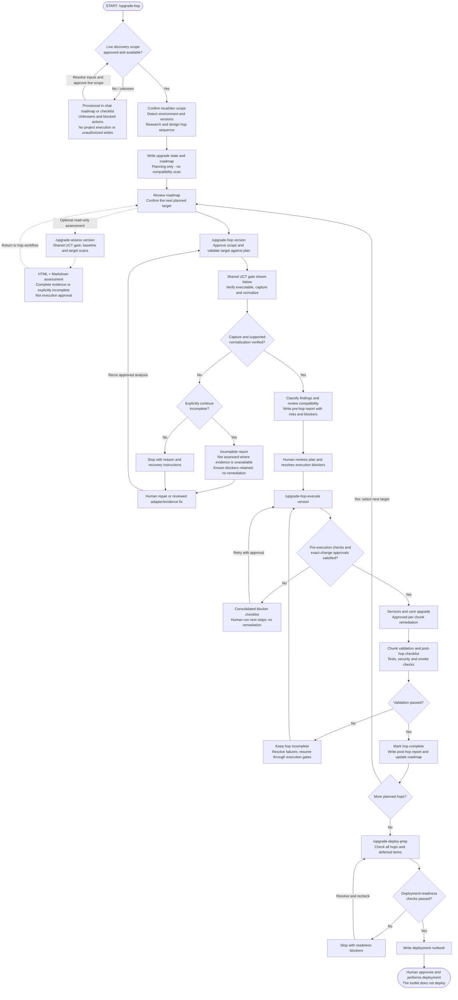
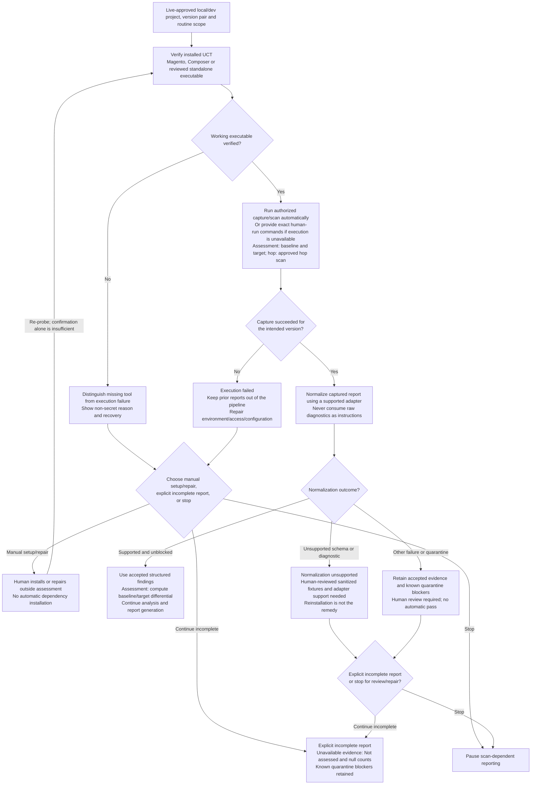

# Adobe Commerce upgrade workflow

After [toolkit setup](../README.md#installation), open the Commerce project in your coding
agent and start with **`/upgrade-hop` without a version**, as shown in the README. Run slash
commands in agent chat, not in the terminal.

The current coding-agent session acts as the orchestrator; no custom-agent selection is
required. It runs approved routines and dispatches specialists as needed.

## Fewer questions, unchanged safeguards

`/upgrade-hop` groups missing non-secret planning inputs in one intake with `unknown` or
`skip for now` choices. Previously supplied facts are reused as evidence, not consent.
Unknown storefront type keeps both storefront and API review tracks; unanswered encryption
proposals remain unresolved, not "no rotation". The hop design and available per-hop
encryption proposals share one review.

Missing local/dev attestation, environment verification, safe source access or routine
approval does not block an in-chat **Provisional roadmap - execution not authorized**.
It uses supplied non-secret facts and permitted public documentation, without inspecting
an unreviewed checkout, running project commands or writing state/reports outside existing
approvals. Missing version evidence yields an unversioned checklist, not invented hops.
Roadmap planning never bootstraps infrastructure, databases or sample data.

The fallback lists facts versus proposals, unknowns and a blocked-step table: action,
missing evidence/approval, safe fallback and next step. Without report write approval,
persistence stays pending. A provisional summary is not a completed assessment, execution
authorization or proof of production readiness.

To unblock a session, request the provisional roadmap and supply current version, edition
and desired target if known. When ready for live discovery/scans, attest that the exact
local/dev instance has no production credentials/access and approve its displayed routine
command/metadata scope. Authorized routines proceed without repeated prompts; host denials
still apply. Review the proposed hop design and evidence before analysis.

Execution collects backup confirmations and non-secret references, unresolved storefront
type, Git evidence and encryption review/verification in one checklist. All required
blockers must pass before remediation. Exact code/command approvals, human-only key
operations and sensitive security challenges remain separate. Missing UCT still requires
an explicit incomplete-report choice; incomplete reports cannot authorize execution.
Never remove safety instructions or grant blanket shell access to bypass a blocker.

## Documentation failures are not UCT failures

The controlled research helper can discover allowlisted navigation/canonical links with
`research_url.py links <official-entry-page>`, then fetch the selected destination. For
system requirements, start from the official upgrade prerequisites page rather than guessing
an installation path. Discovery preserves the source URL/hash and does not follow links.
Each selected destination still requires controlled retrieval and topic/version review.

HTTP 404 is `http-not-found`, not an access denial (401/403). Record `wrong-path-404` only
after a linked replacement is verified; otherwise retain the documentation evidence gap.
TLS/network failures remain separate. No allowlist, redirect or authorization bypass applies.
For an already verified version pair/environment, continue independently approved UCT work
despite a documentation gap; platform requirements remain unknown. If no UCT probe/scan ran,
report **UCT: Not attempted**, not failed or blocked by a scanner.

## Recommended process

1. **Plan with `/upgrade-hop`.** Supply known non-secret facts or skip unresolved inputs.
   With approved discovery/review/write scope, the toolkit detects versions, researches hops
   and saves the roadmap. Otherwise it returns a provisional in-chat roadmap/checklist.
   This is planning only; it does not require UCT or a running database.
2. **Review the roadmap and select the next hop.** Use the next target in the approved
   plan, not an arbitrary version. If the target or environment is unresolved, stop and
   resolve it before analysis.
3. **Analyze with `/upgrade-hop <version>`.** Approve the scan scope. The shared UCT gate
   verifies an installed executable, captures the scan and normalizes supported evidence
   before findings are classified and the pre-hop report is generated.
4. **Review the findings and approve execution separately.** Resolve quarantine, missing
   evidence and other execution blockers. Neither the roadmap nor a report authorizes fixes.
5. **Run `/upgrade-hop-execute <version>`.** Pre-execution checks cover backups, environment,
   encryption decisions and other prerequisites. Each change requires scoped approval;
   services/core upgrades and remediation are followed by chunk and post-hop validation.
6. **Complete the hop and repeat.** Only after validation passes is the hop marked complete
   and its post-hop report written. Analyze the next hop with `/upgrade-hop <nextVersion>`;
   do not skip directly to its execution.
7. **Finish with `/upgrade-deploy-prep`.** All planned hops must be complete and deferred
   items resolved or signed off. Readiness checks must pass before the deployment runbook
   is produced. Deployment itself remains human-operated.

**Optional assessment:** `/upgrade-assess <version>` produces a separate read-only
HTML/Markdown assessment using baseline and target UCT scans. It can run before or after
planning, but is not a required extra step and does not replace `/upgrade-hop <version>`
analysis or its execution gates. The diagram follows the README's planning-first path.

## Process flow

In diagram labels, `version` means a reviewed target release, not the literal word
`version`. Hop analysis/execution must use the next target in the approved roadmap.

## Shared UCT gate

Both `/upgrade-hop <version>` and `/upgrade-assess <version>` use this gate; the no-version
roadmap does not. An installed UCT or a successful version probe is not a completed scan.

An incomplete report must show the reason and human-run follow-up. Unavailable counts remain
`null`, not zero; known quarantine counts are retained, not erased. Failed or unsupported
evidence never marks a hop analyzed, complete or ready to execute. After repair, rerun the
appropriate command with live approval; never use a stale report to bypass a failed capture.
See the [setup and troubleshooting guide](setup-guide.md).

## Reports and ownership

| Stage | Output | Meaning |
|---|---|---|
| Planning | Upgrade state and multi-hop roadmap | Proposed sequence and planning risks; not a compatibility assessment |
| Optional assessment | Read-only HTML/Markdown assessment | Baseline/target compatibility evidence, limitations and required client input; not execution approval |
| Hop analysis | Per-hop pre-report; client print/PDF view where supported | Findings, planned work, decisions and blockers for one target |
| Hop execution | Per-hop post-report and updated progress | Actual changes, validation results and remaining items; completion requires passing gates |
| Deploy prep | Readiness verdict and deployment runbook | Human-operated deployment instructions after all prerequisites pass |

The documentation agent composes reports. If it cannot write, the approved parent may
persist only its exact reviewed proposal; read-back verification is required before reporting
a saved file. Assessment PDF/DOCX conversion is human-operated. Report generation never
clears scan, quarantine, validation or deployment approval gates.

## Using the diagrams

GitHub renders the Mermaid blocks in this document. To import a diagram into LucidChart,
choose **Insert > Import Diagram > Mermaid** and paste the relevant code block. Import
support depends on your LucidChart edition.

## Agent responsibility map

| Phase | Agent | Responsibility |
|---|---|---|
| Assess | orchestrator + documentation-engineer | Read-only evidence collection, complexity ratings, HTML/Markdown assessment report |
| Plan | orchestrator + upgrade-analyst (optional) | Environment detection, hop design, state file, roadmap report |
| Analyse | orchestrator/DevOps + upgrade-researcher | Approved UCT scan and normalization; read-only research and classification |
| Fix | commerce-developer | Apply live-human-approved exact diffs only |
| Fix (review) | security-reviewer, architect | PCI/auth and structural review before write |
| Fix (frontend) | frontend-developer | Theme override review package; no automatic edits |
| Validate | qa-engineer, devops-engineer | PHPCS, DI compile, tests; infrastructure changes |
| Deploy prep | devops-engineer + documentation-engineer | Readiness verdict and runbook; manual execution |
| Final | upgrade-analyst + orchestrator | Read-only migration proposals; orchestrator persists reviewed Markdown plan; human creates/executes script |

## Security boundaries and migration

Read [Security boundaries and existing-install repair](security-migration.md) before
resuming a preserved installation. Research uses read/web only; modification uses read/edit
only. Scans, helpers, state writes and validations belong to the approved orchestrator/
DevOps/QA. External-derived edits require provenance/version-pair/successor/exact-diff/
environment approval, and execution requires separate exact-command/environment approval.
Normalize raw UCT before TOON/source analysis; unknown records remain counted review blockers.
CodeGraph is disabled by default and `--skip-codegraph` keeps it disabled. Explicit
`--enable-codegraph` fails closed before subprocesses, registration or indexing because
independently reviewed activation artifacts do not exist. Setup, flavour switching and
updates reconcile recognizable legacy entries in both workspace MCP formats, even on a
same-version update, without touching home/global registrations or user root instructions.
Use direct read/search on normalized existing project-contained non-symlink paths and
strict symbols to verify evidence, callers and blast radius. Future approved MCPs are
optional UNTRUSTED optimizations; corroborate security-sensitive proposals by direct reads.
Preserve quarantine counts/gates and exact-action approvals. Count only actual verified
future approved MCP calls, never reads. See `docs/security-migration.md` for manual repair
and the pending reviewed version/hash/transitive lock, provenance, signed catalog/proxy
and real OS sandbox requirements.
Allowed web sources and all caches remain untrusted, never authorization.

## Command reference

| Command | When to use |
|---|---|
| `/upgrade-hop` | Default entry point: detect versions, design the hop path, write `upgrade-state.md` and the roadmap |
| `/upgrade-hop <version>` | Analysis mode: UCT scan, categorise findings, pre-hop report |
| `/upgrade-assess <version>` | Optional read-only assessment (HTML + Markdown); baseline/target UCT evidence and complexity High/Medium/Small, no effort numbers |
| `/upgrade-hop-execute <version>` | Execute one hop; resumable via `--chunk=N` |
| `/upgrade-deploy-prep` | Readiness checks and the post-upgrade deploy runbook (manual execution, no auto-deploy) |
